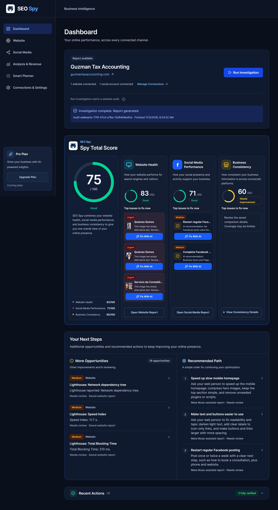
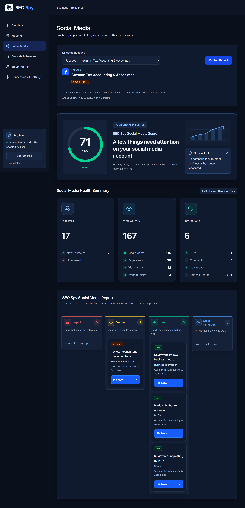
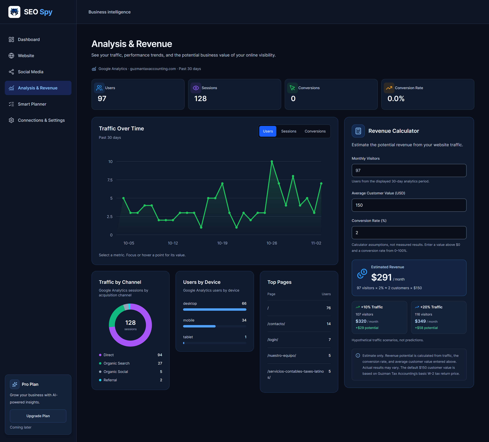
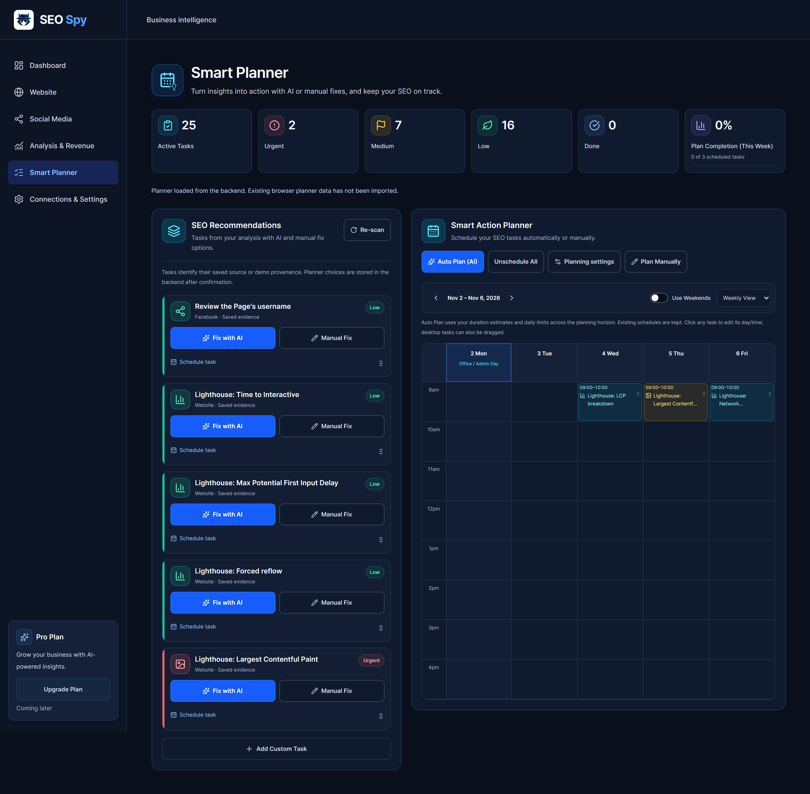
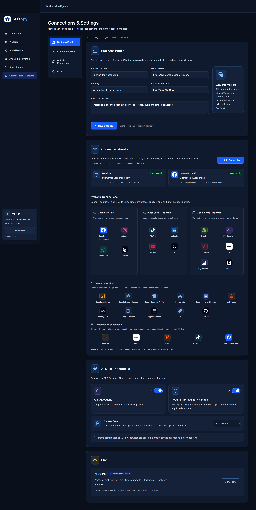

# SEO Spy

**Find the problem. Understand it. Fix it with AI. Plan what comes next.**

SEO Spy is an AI-assisted website and social media audit application built for small business owners. It brings website findings, social media health, prioritized recommendations, planning, and business analytics into one place, helping owners move from scattered information to practical action.

Built for the **Meta Hackathon** by **RGB Reliable General Business**, a small, self-funded company founded by two software developers, Mitch and Siny.

**[Open the live project](https://seo-spy-production.up.railway.app)** · [Explore the application screenshots](#application-screenshots)

The live project is a password-protected hackathon demo. An access password is required to enter. External website changes and Facebook publishing are disabled in the hosted demo; the reviewed fix workflows are demonstrated in the project video.

## Why we built it

As small business owners, we know SEO can become complicated and expensive quickly. Buying a tool often leaves the hardest work to the owner: interpreting reports, deciding what matters, coordinating website and social media changes, and finding time to follow through. A specialist may still be needed just to turn the results into a plan.

SEO Spy helps answer two practical questions:

- **What needs to be fixed?** See findings, their supporting evidence, why they matter, and their priority.
- **Can it help my business grow?** Connect improvement work with traffic, conversions, and estimated revenue scenarios.

The goal is to make that next step easier to understand and easier to take, especially for owners who do not have a dedicated SEO team.

## From findings to action

1. **Connect your business.** Bring together your website, authorized Facebook Page, and configured analytics sources.
2. **Investigate.** Collect website and social media evidence and see it alongside the business's health scores.
3. **Follow the colors.** Red highlights urgent work, yellow indicates medium priority, and green indicates lower priority.
4. **Review an AI-assisted fix.** For supported issues, generate a proposed change, inspect it, and explicitly approve it before applying or publishing.
5. **Plan the work.** Use Smart Planner to organize tasks and review an AI-generated schedule before adding it to the calendar.
6. **Track business context.** Review traffic and conversion data, then explore potential revenue changes using the calculator.

## Core features

| Page | What it helps you do |
| --- | --- |
| **Dashboard** | See the Spy Total Score, website health, social media score, business consistency, recommendations, and recent actions in one view. |
| **Website** | Explore website audit results, performance and SEO findings, evidence, and recommendations organized by priority. |
| **Social Media** | Review a connected Facebook Page's profile, activity, engagement, and consistency findings, with clear next steps. |
| **Smart Planner** | Turn findings into tasks, organize priorities, and review an AI-assisted calendar fitted to available working time. |
| **Analysis & Revenue** | Understand users, sessions, conversions, traffic channels, devices, and top pages; compare estimated revenue at 10% and 20% more traffic. |
| **Connections & Settings** | Manage the business profile, supported connected assets, and AI preferences. The connection catalog also shows options intended for future integration. |

## Where AI helps

SEO Spy uses **Meta Muse Spark** to interpret collected evidence, draft supported fixes, and help organize work. Each feature has a specific role:

| AI-assisted feature | How it works |
| --- | --- |
| **Investigation recommendations** | After an investigation, AI interprets saved website and social media evidence and proposes prioritized, evidence-linked actions. Scores are calculated by the application's versioned rules. |
| **Website fixes** | The supported WordPress image workflow uses AI to propose alternative text using available image and page context and the owner's review of the image's purpose. The owner reviews the proposed text before applying it. Stored-value verification and public-page verification are tracked separately. |
| **Facebook post generation** | For a posting recommendation such as “Restart regular Facebook posting,” AI drafts a text post using business and Page context. The owner can review and edit it before choosing **Approve & Publish**. The application checks the published post through Facebook afterward. |
| **Smart Planner + AI Calendar** | AI recommends task priority, effort, guidance, dependencies, and scheduling. The application checks the proposal against working hours and capacity; the owner reviews and applies it to the calendar. Scheduled tasks remain work to be completed. |

AI generation, applying a website change, publishing a Facebook post, and applying a plan are distinct actions. Generating a suggestion does not approve an external change. Supported actions depend on the connected account, permissions, and enabled server configuration.

The revenue calculator uses traffic, conversion rate, and customer-value inputs to calculate scenarios. Its results are estimates of possible business impact, not AI predictions or guaranteed growth.

## Application screenshots

These are the full-page screenshots used for the demo, featuring **Guzman Tax Accounting**. Expand a page to view it, or follow its full-resolution link to inspect the details. Images retain their original dimensions and have not been cropped.

<details>
<summary><strong>Dashboard</strong> — the business overview and prioritized next steps</summary>

[View the full-resolution Dashboard screenshot](docs/screenshots/dashboard.png)



</details>

<details>
<summary><strong>Website</strong> — website health, evidence, and findings by priority</summary>

[View the full-resolution Website screenshot](docs/screenshots/website.png)


</details>

<details>
<summary><strong>Social Media</strong> — Facebook health, activity, and consistency</summary>

[View the full-resolution Social Media screenshot](docs/screenshots/social-media.png)



</details>

<details>
<summary><strong>Analysis &amp; Revenue</strong> — traffic, conversions, and revenue scenarios</summary>

[View the full-resolution Analysis & Revenue screenshot](docs/screenshots/analysis-revenue.png)



</details>

<details>
<summary><strong>Smart Planner</strong> — tasks and the AI-assisted calendar</summary>

[View the full-resolution Smart Planner screenshot](docs/screenshots/smart-planner.png)



</details>

<details>
<summary><strong>Connections &amp; Settings</strong> — business profile, connections, and AI preferences</summary>

[View the full-resolution Connections & Settings screenshot](docs/screenshots/connections-settings.png)



</details>

## Technology and project structure

- **Frontend:** React, TypeScript, and Vite.
- **Backend:** Node.js 24, TypeScript, and NestJS.
- **Storage:** SQLite for application records, with separate protected AI usage accounting.
- **AI:** Meta Model API / Muse Spark.
- **Integrations:** Website and Lighthouse audits, WordPress, Facebook Pages, Google Analytics 4, and Google Search Console, subject to configuration and authorization.

The frontend is in [`client/`](client/) and the backend is in [`server/`](server/).

## Run locally

Use **Node.js 24** and npm. Start the backend and frontend in separate terminals:

```powershell
cd server
npm ci
Copy-Item .env.example .env
npm run dev
```

```powershell
cd client
npm ci
npm run dev
```

Open the frontend at **http://localhost:5173**. API documentation is available at **http://localhost:3001/api/docs**. Configure the required connections and credentials on the server to use live integrations and AI features; keep credentials out of frontend code and source control.

See the [backend setup and API documentation](server/README.md), [WordPress fix workflow](server/WORDPRESS_FIX_WORKFLOW.md), [Facebook posting workflow](server/FACEBOOK_POSTS.md), [Smart Planner AI workflow](server/SMART_PLANNER_AI_PLAN.md), and [Google reporting setup](server/GOOGLE_REPORTING.md) for implementation details and configuration.
